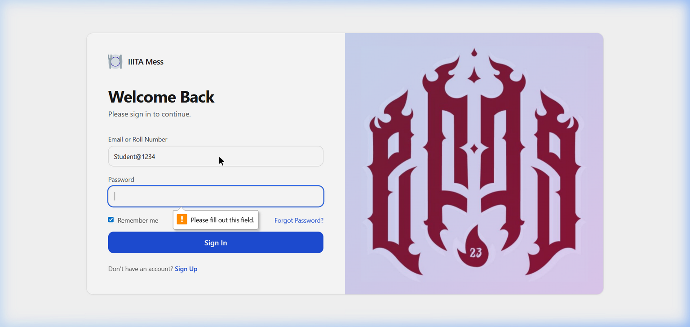
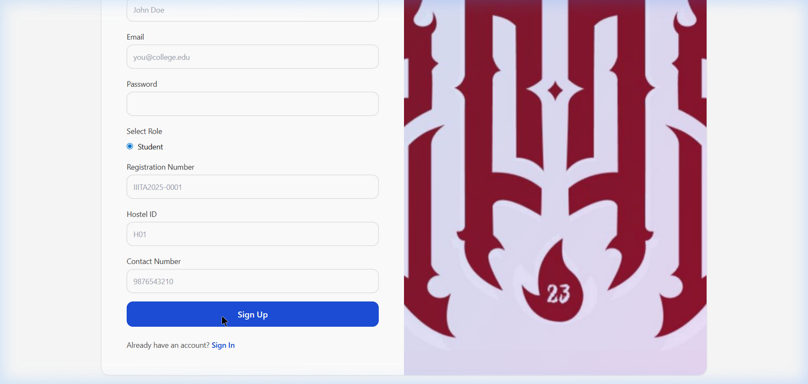
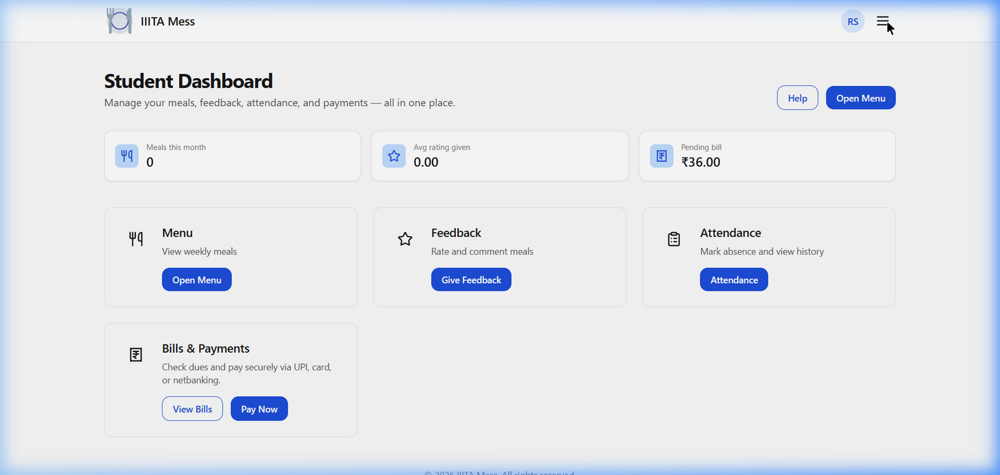
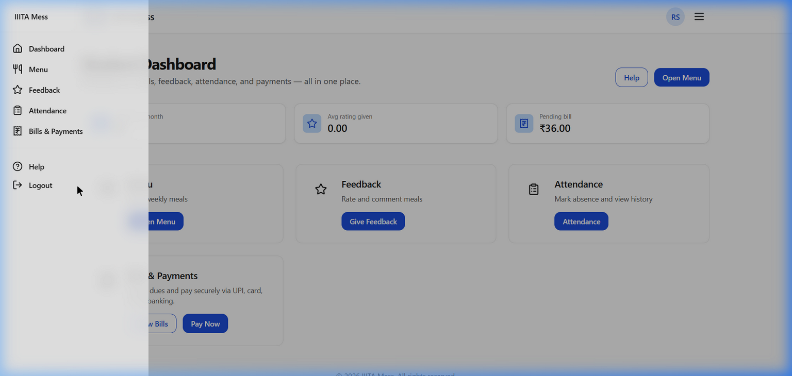
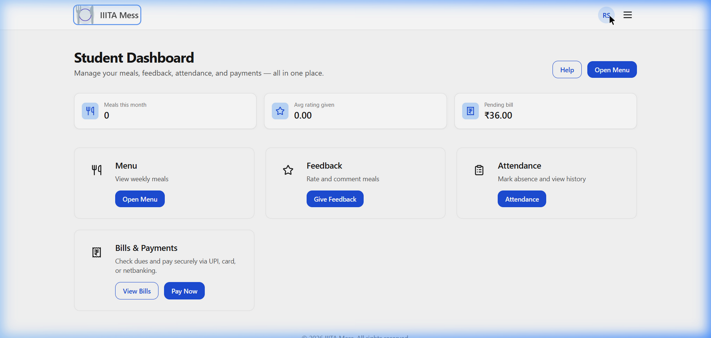
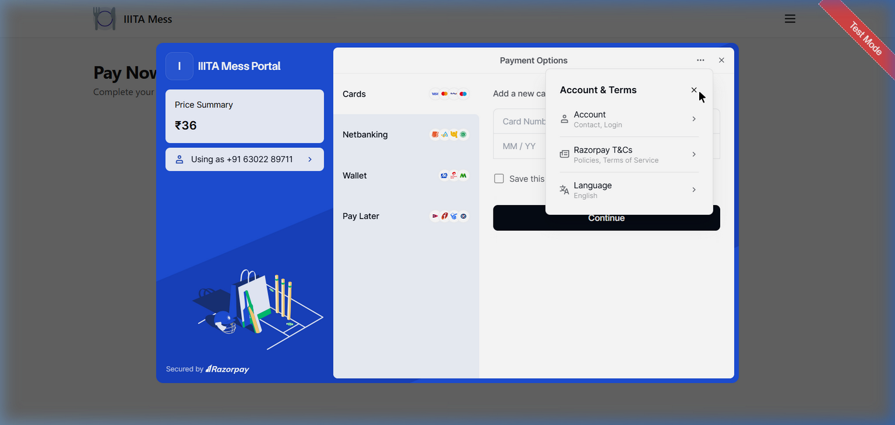
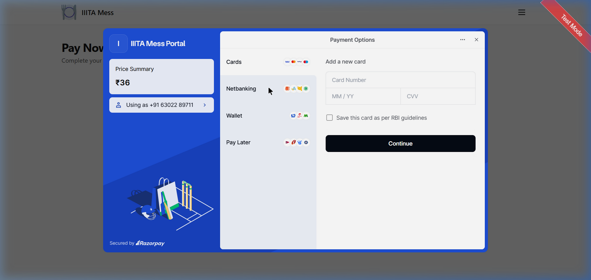
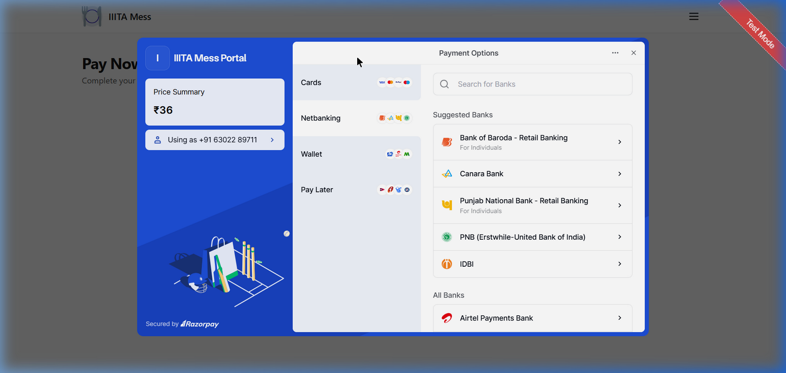
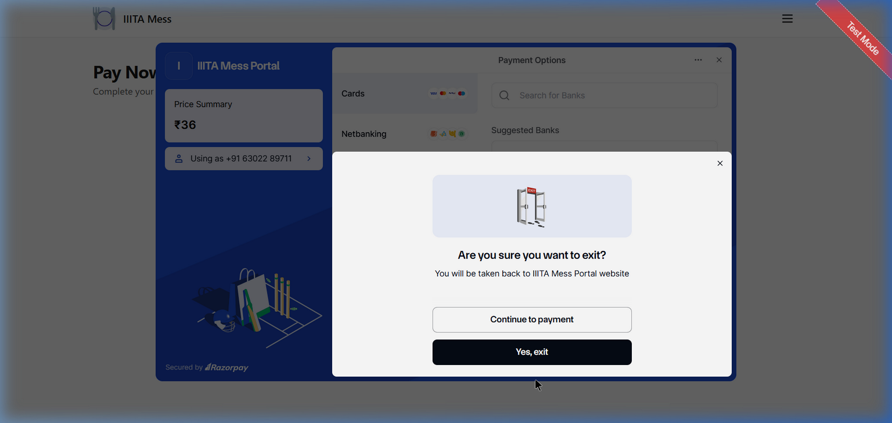

# 🍽️ IIITA Hostel Mess Management System

A full-stack web application for managing the hostel mess at **IIIT Allahabad**. It digitizes the entire mess lifecycle — from menu management and QR-based meal attendance to automated bill generation and secure Razorpay payment processing — across three distinct roles: **Student**, **Mess Manager**, and **Hostel Admin**.

---

## 📋 Table of Contents

- [Overview](#overview)
- [Features](#features)
- [Tech Stack](#tech-stack)
- [System Architecture](#system-architecture)
- [Roles & Permissions](#roles--permissions)
- [Project Structure](#project-structure)
- [Database Models](#database-models)
- [API Reference](#api-reference)
- [Setup & Installation](#setup--installation)
- [Environment Variables](#environment-variables)
- [Razorpay Integration](#razorpay-integration)
- [Authentication](#authentication)
- [Screenshots](#screenshots)

---
## Architecture


---

## 📝 Changelog

### v2.0 — May 2026 (Current)

#### ✅ Feedback — Attendance-Gated Submission
- Students can **only submit feedback for meals they physically scanned into** via QR
- New endpoint `GET /api/feedback/eligible-meals` returns meals where feedback window is open
- **Feedback window**: same day of meal OR by **end-of-day the following day** (e.g., ate Lunch on 5th → can rate until 6th 11:59 PM)
- One feedback per student per meal per date enforced

#### ✅ Discount & Waiver UI (Admin)
- **Payment Records** page now has a `💸 Discount / Waive` button on every unpaid/overdue bill
- **Full waiver**: one-click "⚡ Waive Full Bill" sets status to `waived` automatically
- **Partial discount**: enter custom amount + choose reason (scholarship, medical leave, billing error, mess closure)
- Discount + reason stored on bill; displayed on the card after applying

#### ✅ Bill Model — Waived Status Fixed
- Pre-save hook now checks `totalAmount <= 0` **before** paid/overdue checks (was incorrectly ordered)
- Uses `Math.round(...*100)/100` to eliminate floating-point residuals that prevented exact `=== 0` matches
- `billValidator.js` updated to accept `discount` + `discountReason` fields (was `discountAmount` + `reason`)

#### ✅ System Reports — Admin Fixed
- `getFeedbackStatistics` now works system-wide for admin (no `hostelId` required)
- `getAllBillsStats` now returns `totalAmount`, `totalCollected`, `totalDue` for revenue display
- SystemReports page rebuilt: added revenue KPI row, category breakdown chart, rating distribution pie, and billing status explanation table
- All empty states handled gracefully

#### ✅ Demo Seed — Fixed Double-Hashing
- `seedDemo.js` now passes plain-text passwords; User model pre-save hook hashes once
- Seeds: 1 admin · 3 managers · 10 students · 600 attendance · 30 bills · 117 feedbacks

---

## 💳 Bill Status Glossary

| Status | Meaning | When set |
|--------|---------|----------|
| **Unpaid** | No payment made yet | Default after bill generation |
| **Partially Paid** | Some amount paid; balance still due | When `amountPaid > 0` and `amountDue > 0` |
| **Paid** | Full amount settled | When `amountDue <= 0` |
| **Overdue** | Past due date with balance outstanding | When `now > dueDate` and `amountDue > 0` |
| **Waived** | Admin-approved exemption | When admin applies discount = full bill amount (scholarship, medical leave, billing error, mess closure) |

---

## Overview

The IIITA Mess Management System replaces manual paper-based processes with a unified digital platform. Students scan QR codes to mark attendance at each meal, managers generate daily QR tokens and manage menus, and admins generate bills based on actual meal consumption and collect payments via Razorpay.

### Hostels Supported
`BH-1` `BH-2` `BH-3` `BH-4` `BH-5` `GH-1` `GH-2` `GH-3`

### Meal Schedule
| Meal | Time Window |
|------|------------|
| 🌅 Breakfast | 7:00 AM – 10:00 AM |
| ☀️ Lunch | 12:00 PM – 3:00 PM |
| 🌙 Dinner | 7:00 PM – 10:00 PM |

---

## Features

### 🎓 Student Features
- **Dashboard** — Live stats: meals this month, pending bill amount, average feedback rating
- **Menu Viewer** — View the weekly mess menu for breakfast, lunch, and dinner
- **QR Meal Scanning** — Scan daily QR codes displayed at the mess entrance to mark attendance
- **Attendance History** — View personal attendance records with monthly summaries
- **Leave Management** — Mark planned absences (vacation, sick leave, home visit, etc.)
- **Bill Viewer** — View monthly bills with expandable meal-wise breakdown (e.g., Breakfast: 22 × ₹30 = ₹660)
- **Pay Bills** — Select pending bills and pay securely via Razorpay (UPI / Card / Netbanking)
- **Feedback** — Rate meals (1–5 ★) with category ratings, tags, and comments. **Gated by QR attendance** — you can only submit feedback for a meal you actually scanned into. Submission window closes at end-of-day the day after the meal (e.g., ate on 5th → can rate until 6th 11:59 PM)
- **Profile Page** — Account info, bill summary stats, this month's meal counts, recent bill history
- **Flexible Login** — Sign in using email address **or** roll number (case-insensitive: `IEC2022047`, `iec2022047`, `iEc2022047`)

### 🍽️ Mess Manager Features
- **Dashboard** — Hostel overview: students count, bills generated, feedback stats
- **Menu Management** — Create, update, and publish the weekly mess menu
- **QR Code Generation** — Generate daily meal-specific QR tokens for students to scan
- **Feedback Analytics** — Visual charts (bar, pie) of student feedback ratings and tags
- **Attendance Insights** — Per-hostel attendance trends and daily summaries
- **Feedback Reports** — View and filter all student feedback submissions
- **Profile Page** — Hostel stats: total students, bills this month, pending payment count

### 🔑 Admin Features
- **Dashboard** — System-wide stats: total students, total bills, paid vs unpaid counts
- **Meal-wise Bill Generation** — Set individual rates for breakfast, lunch, dinner per hostel/month; bills are auto-calculated from actual QR attendance data
- **Payment Records** — View and filter all student bills by hostel, status, or name/roll number. **Apply Discount or Full Waiver** per student via the 💸 button — choose a reason (scholarship, medical leave, billing error, mess closure) and apply
- **System Reports** — Live charts: payment status pie, meal rating bars, category breakdown, rating distribution, revenue row (Billed / Collected / Outstanding). Export to PDF
- **User Role Management** — View all users and change their roles (student / manager / admin)
- **Profile Page** — System-wide user count, current month billing summary, revenue collected

---

## Tech Stack

### Frontend
| Technology | Purpose |
|-----------|---------|
| **React 18** | UI framework |
| **Vite** | Build tool & dev server |
| **React Router DOM v6** | Client-side routing |
| **Axios** | HTTP client for API calls |
| **Lucide React** | Icon library |
| **Recharts** | Charts for analytics & reports |
| **jsPDF + html2canvas** | PDF export for system reports |
| **Razorpay Checkout.js** | Payment gateway modal |
| **Vanilla CSS** | Styling (utility classes via index.css) |

### Backend
| Technology | Purpose |
|-----------|---------|
| **Node.js** | Runtime environment |
| **Express.js v5** | Web framework |
| **MongoDB** | NoSQL database |
| **Mongoose** | MongoDB ODM |
| **JSON Web Tokens (JWT)** | Authentication |
| **bcryptjs** | Password hashing |
| **express-validator** | Request validation |
| **Razorpay Node SDK** | Payment gateway server-side |
| **dotenv** | Environment variable management |
| **nodemon** | Dev server auto-restart |

---

## System Architecture

```
┌─────────────────────────────────────────────────────────┐
│                     CLIENT (React + Vite)               │
│  ┌──────────┐  ┌──────────┐  ┌──────────┐              │
│  │ Student  │  │ Manager  │  │  Admin   │  (Role Views) │
│  └──────────┘  └──────────┘  └──────────┘              │
│        │              │              │                   │
│        └──────────────┴──────────────┘                  │
│                    Axios (HTTP)                          │
└─────────────────────────┬───────────────────────────────┘
                          │ REST API
┌─────────────────────────▼───────────────────────────────┐
│                   SERVER (Express.js)                    │
│  ┌─────────────────────────────────────────────────┐    │
│  │  Routes → Controllers → Services → Models       │    │
│  └─────────────────────────────────────────────────┘    │
│  Middleware: JWT Auth → Role Guard → Validator          │
│  Payment: Razorpay SDK + HMAC-SHA256 Verification       │
└─────────────────────────┬───────────────────────────────┘
                          │ Mongoose
┌─────────────────────────▼───────────────────────────────┐
│              MongoDB Atlas (Cloud Database)              │
│  Users │ Bills │ Attendance │ Menus │ Feedback │ Tokens  │
└─────────────────────────────────────────────────────────┘
```

### Payment Flow (Razorpay)
```
Student selects bills
       ↓
POST /api/payments/create-order  →  Razorpay Order created server-side
       ↓
Razorpay Checkout Modal opens (UPI / Card / Netbanking)
       ↓
Student completes payment
       ↓
POST /api/payments/verify  →  Server verifies HMAC-SHA256 signature
       ↓
✅ Verified → Bill marked PAID  |  ❌ Failed → Bill stays UNPAID
```

### QR Attendance Flow
```
Manager generates QR token for meal (e.g. Lunch, May 4)
       ↓
QR displayed at mess entrance
       ↓
Student scans QR via /scan-meal page
       ↓
Server validates: token valid + within meal time window + not already scanned
       ↓
Attendance record created → Used for bill calculation
```

---

## Roles & Permissions

| Feature | Student | Manager | Admin |
|---------|:-------:|:-------:|:-----:|
| View Menu | ✅ | ✅ | ✅ |
| Give Feedback | ✅ | ❌ | ❌ |
| Scan QR for Attendance | ✅ | ❌ | ❌ |
| View Own Bills | ✅ | ❌ | ❌ |
| Pay Bills (Razorpay) | ✅ | ❌ | ❌ |
| Manage Menu | ❌ | ✅ | ❌ |
| Generate QR Tokens | ❌ | ✅ | ❌ |
| View Feedback Analytics | ❌ | ✅ | ❌ |
| View Attendance Insights | ❌ | ✅ | ❌ |
| Generate Bills | ❌ | ❌ | ✅ |
| View All Payment Records | ❌ | ✅ | ✅ |
| System Reports | ❌ | ❌ | ✅ |
| Manage User Roles | ❌ | ❌ | ✅ |
| View Profile (/me) | ✅ | ✅ | ✅ |

---

## Project Structure

```
Hostel-Mess-Management-System/
├── client/                          # Frontend (React + Vite)
│   ├── index.html                   # HTML entry point (loads Razorpay script)
│   ├── vite.config.js
│   └── src/
│       ├── main.jsx                 # React entry point
│       ├── App.jsx                  # Routes & role-based guards
│       ├── api/                     # Axios API functions
│       │   └── billAPI.js           # Bills, payments, Razorpay API calls
│       ├── assets/                  # Images, logo
│       ├── components/              # Reusable UI components
│       │   ├── Navbar.jsx           # Top bar (logo nav + avatar → /me)
│       │   ├── Sidebar.jsx          # Role-aware navigation sidebar
│       │   ├── PageLayout.jsx       # Page shell (Navbar + Sidebar + content)
│       │   ├── RouteGuards.jsx      # ProtectedRoute + GuestRoute
│       │   ├── Card.jsx
│       │   ├── StatBadge.jsx
│       │   ├── PrimaryButton.jsx
│       │   ├── OutlineButton.jsx
│       │   ├── LoadingScreen.jsx
│       │   ├── EmptyState.jsx
│       │   ├── HostelSelect.jsx     # Reusable hostel dropdown
│       │   └── MonthPicker.jsx
│       ├── config/
│       │   └── api.js               # API_BASE_URL config
│       ├── constants/
│       │   └── index.js             # HOSTELS list for dropdowns
│       └── pages/
│           ├── SignIn.jsx           # Login (email OR roll number)
│           ├── SignUp.jsx
│           ├── StudentDashboard.jsx
│           ├── MessManagerDashboard.jsx
│           ├── HostelAdminDashboard.jsx
│           ├── Menu.jsx
│           ├── Feedback.jsx
│           ├── Attendance.jsx
│           ├── ScanMeal.jsx         # QR scanner for students
│           ├── GenerateQR.jsx       # QR generator for managers
│           ├── ManageMenus.jsx
│           ├── FeedbackAnalytics.jsx
│           ├── FeedbackReports.jsx
│           ├── AttendanceInsights.jsx
│           ├── ViewBills.jsx        # Bill viewer with meal breakdown
│           ├── PayPendingBills.jsx  # Bill selector
│           ├── PayNow.jsx           # Razorpay checkout
│           ├── PaymentRecords.jsx   # Admin payment management
│           ├── GenerateBills.jsx    # Meal-wise bill generation
│           ├── SystemReports.jsx    # Charts + PDF export
│           ├── UserRoles.jsx        # Role management
│           ├── Help.jsx
│           └── profile/
│               ├── ProfilePage.jsx  # Orchestrator (/me route)
│               ├── StudentProfile.jsx
│               ├── ManagerProfile.jsx
│               └── AdminProfile.jsx
│
└── server/                          # Backend (Node.js + Express)
    ├── server.js                    # Entry point
    ├── app.js                       # Express app + route mounting
    ├── seed.js                      # Database seed script
    ├── config/
    │   └── db.js                    # MongoDB connection
    ├── constants/
    │   └── index.js                 # HOSTELS, MEAL_TYPES, ROLES, rates
    ├── controllers/
    │   ├── authController.js
    │   ├── billController.js
    │   ├── attendanceController.js
    │   ├── feedbackController.js
    │   ├── menuController.js
    │   ├── mealTokenController.js
    │   ├── paymentController.js     # Razorpay
    │   ├── profileController.js     # Role-specific profile
    │   ├── reportController.js
    │   └── userController.js
    ├── middleware/
    │   ├── authMiddleware.js        # JWT verify → req.user
    │   ├── roleMiddleware.js        # authorize('admin', 'manager')
    │   └── errorMiddleware.js       # Global error handler
    ├── models/
    │   ├── User.js
    │   ├── Bill.js                  # Meal-wise charges + payment history
    │   ├── Attendance.js
    │   ├── Feedback.js
    │   ├── Menu.js
    │   └── MealToken.js             # QR attendance tokens
    ├── routes/
    │   ├── authRoutes.js
    │   ├── billRoutes.js
    │   ├── attendanceRoutes.js
    │   ├── feedbackRoutes.js
    │   ├── menuRoutes.js
    │   ├── mealTokenRoutes.js
    │   ├── paymentRoutes.js
    │   ├── profileRoutes.js
    │   ├── reportRoutes.js
    │   └── userRoutes.js
    ├── services/
    │   ├── authService.js
    │   ├── billService.js
    │   ├── attendanceService.js
    │   ├── feedbackService.js
    │   ├── menuService.js
    │   ├── paymentService.js        # Razorpay + HMAC verification
    │   ├── profileService.js        # Role-specific profile data
    │   ├── reportService.js
    │   └── userService.js
    ├── utils/
    │   ├── asyncHandler.js          # Wraps async controllers
    │   ├── AppError.js              # Custom error class
    │   └── apiResponse.js           # sendSuccess, sendCreated, sendPaginated
    └── validators/
        └── authValidator.js         # Registration + login validation
```

---

## Database Models

### User
| Field | Type | Notes |
|-------|------|-------|
| name | String | Required |
| email | String | Unique, lowercase |
| password | String | Hashed with bcryptjs |
| role | Enum | `student` / `manager` / `admin` |
| registrationNumber | String | Unique, sparse (students) |
| hostelId | Enum | Required for students & managers |
| contactNumber | String | 10 digits |
| isActive | Boolean | Default: true |

### Bill
| Field | Type | Notes |
|-------|------|-------|
| studentId | ObjectId → User | |
| hostelId | String | |
| month / year | Number | Billing period |
| mealWiseCharges | Array | `[{ mealType, daysConsumed, rate, totalAmount }]` |
| discount | Number | Applied by admin; reduces totalAmount |
| discountReason | String | Reason for waiver (e.g. scholarship, billing error) |
| totalAmount | Number | Auto-calculated: baseAmount + fixedCharges + lateFee + adjustments − discount |
| amountPaid | Number | |
| amountDue | Number | Auto-calculated |
| paymentStatus | Enum | `unpaid` · `partially_paid` · `paid` · `overdue` · `waived` |
| paymentHistory | Array | `[{ amount, method, transactionId, remarks }]` |

### MealToken (QR)
| Field | Type | Notes |
|-------|------|-------|
| hostelId | String | |
| mealType | Enum | `breakfast` / `lunch` / `dinner` |
| date | Date | Token valid date |
| token | String | Unique QR payload |
| expiresAt | Date | End of meal time window |

### Attendance
| Field | Type | Notes |
|-------|------|-------|
| studentId | ObjectId | |
| hostelId | String | |
| date | Date | |
| meals | Object | `{ breakfast, lunch, dinner }` → present/absent |
| scannedAt | Array | Timestamps of QR scans |

---

## API Reference

### Auth
| Method | Endpoint | Access | Description |
|--------|----------|--------|-------------|
| POST | `/api/auth/register` | Public | Register new user |
| POST | `/api/auth/login` | Public | Login (email or roll number) |
| GET | `/api/auth/me` | Private | Get current user |
| POST | `/api/auth/logout` | Private | Logout |

### Bills
| Method | Endpoint | Access | Description |
|--------|----------|--------|-------------|
| GET | `/api/bills/my-bills` | Student | Get own bills |
| POST | `/api/bills/generate-all` | Admin | Generate bills for all hostel students |
| GET | `/api/bills/mess/:hostelId` | Manager/Admin | Get all bills for a hostel |
| PUT | `/api/bills/mark-paid` | Student | Mark bills paid after Razorpay |
| GET | `/api/bills/stats-all/:month/:year` | Admin | System-wide bill stats with revenue totals |
| GET | `/api/bills/students-count` | Admin | Total active students |
| PUT | `/api/bills/:id/discount` | Admin | Apply discount/waiver `{ discount, discountReason }` |
| PUT | `/api/bills/:id/late-fee` | Admin | Apply late fee |
| PUT | `/api/bills/:id/cancel` | Admin | Cancel a bill |
| GET | `/api/bills/summary/:hostelId/:month/:year` | Manager/Admin | Hostel billing summary |

### Payments (Razorpay)
| Method | Endpoint | Access | Description |
|--------|----------|--------|-------------|
| POST | `/api/payments/create-order` | Student | Create Razorpay order |
| POST | `/api/payments/verify` | Student | Verify HMAC signature + mark paid |

### Profile
| Method | Endpoint | Access | Description |
|--------|----------|--------|-------------|
| GET | `/api/profile/me` | All roles | Role-specific aggregated profile data |

### Attendance
| Method | Endpoint | Access | Description |
|--------|----------|--------|-------------|
| GET | `/api/attendance/monthly/:month/:year` | Student | Own monthly summary |
| GET | `/api/attendance/insights/:hostelId` | Manager/Admin | Hostel attendance trends |

### Meal Tokens (QR)
| Method | Endpoint | Access | Description |
|--------|----------|--------|-------------|
| POST | `/api/meal-tokens/generate` | Manager | Generate QR token for a meal |
| POST | `/api/meal-tokens/scan` | Student | Scan QR and record attendance |
| GET | `/api/meal-tokens/today` | Manager | Get today's tokens |

### Menus
| Method | Endpoint | Access | Description |
|--------|----------|--------|-------------|
| GET | `/api/menu` | All | Get current menu |
| POST | `/api/menu` | Manager | Create/update menu |
| PUT | `/api/menu/:id` | Manager | Update menu item |

### Feedback
| Method | Endpoint | Access | Description |
|--------|----------|--------|-------------|
| GET | `/api/feedback/eligible-meals` | Student | Meals attended + window still open for feedback |
| POST | `/api/feedback` | Student | Submit feedback (requires QR attendance for that meal) |
| GET | `/api/feedback/my-feedback` | Student | Own feedback history |
| GET | `/api/feedback/mess` | Manager/Admin | All feedback for a hostel (filterable) |
| GET | `/api/feedback/pending` | Manager/Admin | Pending feedbacks |
| GET | `/api/feedback/statistics` | Manager/Admin | Avg ratings, meal-wise breakdown, distribution |
| PUT | `/api/feedback/:id/respond` | Manager/Admin | Add manager response |
| PUT | `/api/feedback/:id/status` | Manager/Admin | Update feedback status |

### Users
| Method | Endpoint | Access | Description |
|--------|----------|--------|-------------|
| GET | `/api/users` | Admin | Get all users |
| PUT | `/api/users/:id/role` | Admin | Update user role |

---

## Setup & Installation

### Prerequisites
- **Node.js** v18 or higher — [Download](https://nodejs.org)
- **MongoDB** — Use [MongoDB Atlas](https://www.mongodb.com/atlas) (free tier) or local install
- **Git** — [Download](https://git-scm.com)
- **Razorpay Account** (for payments) — [Sign up free](https://dashboard.razorpay.com)

### 1. Clone the Repository
```bash
git clone https://github.com/YOUR_USERNAME/Hostel-Mess-Management-System.git
cd Hostel-Mess-Management-System
```

### 2. Setup the Server

```bash
cd server
npm install
```

Create a `.env` file inside the `server/` directory:

```env
PORT=5000
MONGO_URI=mongodb+srv://<username>:<password>@cluster0.xxxxx.mongodb.net/mess_db
JWT_SECRET=your_super_secret_key_here
JWT_EXPIRE=7d
NODE_ENV=development
FRONTEND_URL=http://localhost:5173

# Razorpay Payment Gateway
RAZORPAY_KEY_ID=rzp_test_xxxxxxxxxxxxxxxxx
RAZORPAY_KEY_SECRET=xxxxxxxxxxxxxxxxxxxxxxxxx
```

Start the server (development):
```bash
npm run dev
```

The server starts on **http://localhost:5000**

### 3. Setup the Client

```bash
cd client
npm install
npm run dev
```

The frontend starts on **http://localhost:5173**

### 4. Seed Demo Data

Run the demo seed script to populate realistic data (1 admin, 3 managers, 10 students, 600 attendance records, 30 bills, 117 feedback entries):

```bash
cd server
node seedDemo.js
```

#### Demo Credentials

| Role | Email | Password | Hostel |
|------|-------|----------|--------|
| **Admin** | `admin@demo.iiita.ac.in` | `Admin@1234` | — |
| **Manager** | `manager.bh1@demo.iiita.ac.in` | `Manager@1234` | BH-1 |
| **Manager** | `manager.bh2@demo.iiita.ac.in` | `Manager@1234` | BH-2 |
| **Manager** | `manager.gh1@demo.iiita.ac.in` | `Manager@1234` | GH-1 |
| **Student** | `rahul@demo.iiita.ac.in` | `Student@1234` | BH-1 |
| **Student** | `aditya@demo.iiita.ac.in` | `Student@1234` | BH-1 |
| **Student** | `karan@demo.iiita.ac.in` | `Student@1234` | BH-1 |
| **Student** | `sneha@demo.iiita.ac.in` | `Student@1234` | BH-2 |
| **Student** | `neha@demo.iiita.ac.in` | `Student@1234` | GH-1 |

Students can also login with their **roll number** (e.g. `IEC2022001`, case-insensitive).

> ⚠️ Re-running `node seedDemo.js` clears old demo data first — safe to run multiple times.

---

## Environment Variables

| Variable | Required | Description |
|----------|----------|-------------|
| `PORT` | Yes | Server port (default: 5000) |
| `MONGO_URI` | Yes | MongoDB connection string |
| `JWT_SECRET` | Yes | Secret key for signing JWTs |
| `JWT_EXPIRE` | No | Token expiry (default: `7d`) |
| `NODE_ENV` | No | `development` or `production` |
| `FRONTEND_URL` | Yes | Frontend URL for CORS (e.g. `http://localhost:5173`) |
| `RAZORPAY_KEY_ID` | Yes* | Razorpay Key ID (`rzp_test_...` for test) |
| `RAZORPAY_KEY_SECRET` | Yes* | Razorpay Key Secret |

> *Required for the payment feature to work. Use test keys from [Razorpay Dashboard](https://dashboard.razorpay.com) → Settings → API Keys.

---

## Razorpay Integration

### Getting Test Keys
1. Go to [dashboard.razorpay.com](https://dashboard.razorpay.com)
2. Sign up (free) → Settings → API Keys → **Generate Test Key**
3. Copy the `Key ID` and `Key Secret` into your `.env`

### Test Payment Credentials
Use these in the Razorpay checkout modal during testing:

| Method | Test Value |
|--------|-----------|
| UPI (success) | `success@razorpay` |
| UPI (failure) | `failure@razorpay` |
| Card Number | `4111 1111 1111 1111` |
| Card Expiry | Any future date |
| Card CVV | Any 3 digits |

### How Verification Works
The server uses **HMAC-SHA256** to verify every payment:
```
signature = HMAC_SHA256(orderId + "|" + paymentId, RAZORPAY_KEY_SECRET)
```
Bills are only marked `paid` if the signature matches. This makes it impossible for students to fake a payment.

---

## Authentication

### Login Options
Students can log in using either:
- **Email address** — `student1@mess.com`
- **Roll number** — `IEC2022047` or `iec2022047` or `iEc2022047` *(case-insensitive)*

### JWT Tokens
- Tokens expire after **7 days** (configurable via `JWT_EXPIRE`)
- Stored in `localStorage` on the client
- Sent as `Authorization: Bearer <token>` header with every API request

### Route Protection
All pages require authentication. Role-based access is enforced both on the frontend (`RouteGuards.jsx`) and backend (`roleMiddleware.js`).

---

## Screenshots

### 🔐 Authentication

**Sign In** — Login with email or roll number (e.g. `IEC2022047`)



---

**Sign Up** — New user registration with role selection, hostel assignment and registration number



---

### 🎓 Student View

**Student Dashboard** — At-a-glance stats: meals this month, feedback rating, pending bill amount. Quick links to all student features.



---

**Navigation Sidebar** — Role-aware sidebar with all student links (Menu, Feedback, Attendance, Bills & Payments)



---

**Navbar with Avatar** — Clickable IIITA Mess logo navigates home; "RS" avatar (top-right) opens the profile page at `/me`



---

### 💳 Payment (Razorpay)

**Razorpay Checkout — Card Payment** — Secure card payment modal showing price summary (₹36) and card entry form



---

**Razorpay Checkout — Card Entry** — Enter card number, expiry and CVV directly in the secure Razorpay modal



---

**Razorpay Checkout — Netbanking** — Choose from suggested banks (Bank of Baroda, Canara, PNB, etc.) or search all banks



---

**Razorpay Exit Confirmation** — User prompted before leaving the payment flow, preventing accidental exits



---

### 📸 More Screenshots Coming Soon

| Page | Status |
|------|--------|
| Student Profile (`/me`) | 🔜 |
| View Bills (meal-wise breakdown) | 🔜 |
| Attendance History | 🔜 |
| QR Meal Scanner | 🔜 |
| Feedback Form | 🔜 |
| Manager Dashboard | 🔜 |
| Generate QR Code | 🔜 |
| Feedback Analytics | 🔜 |
| Admin Dashboard | 🔜 |
| Generate Bills | 🔜 |
| Payment Records | 🔜 |
| System Reports | 🔜 |
| User Roles Management | 🔜 |

> To add more screenshots: capture the page, save it to `docs/screenshots/`, and add it above following the same format.

---

## Default Meal Rates

| Meal | Default Rate |
|------|-------------|
| 🌅 Breakfast | ₹30 per day |
| ☀️ Lunch | ₹50 per day |
| 🌙 Dinner | ₹50 per day |

Admins can override these rates when generating bills for any given month.

---

## Contributing

1. Fork the repository
2. Create a feature branch: `git checkout -b feature/your-feature-name`
3. Commit your changes: `git commit -m "feat: add your feature"`
4. Push to the branch: `git push origin feature/your-feature-name`
5. Open a Pull Request

---

## License

This project is developed as a **major project** for IIIT Allahabad. All rights reserved.

---

<div align="center">
  <p>Built with ❤️ for IIIT Allahabad</p>
  <p><strong>IIITA Hostel Mess Management System</strong></p>
</div>
